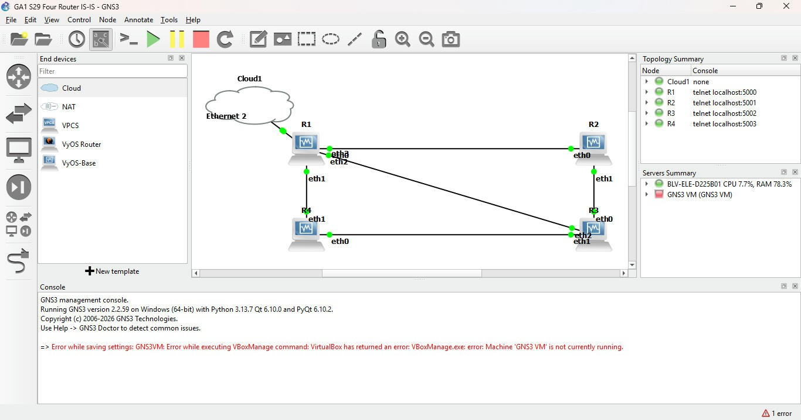

# Four-Router IS-IS Network with an OpenDaylight SDN Controller

A virtual network lab built in **GNS3** and **VirtualBox** for Network Systems 3 (NSS370S) at the Cape Peninsula University of Technology, 2026.

Four **VyOS** routers form a redundant core running **IS-IS**. A separate management LAN connects router R1 to an **OpenDaylight** controller on Ubuntu, which peers with R1 over **iBGP**. A controlled link-failure test shows the network rerouting around a broken link.



## Topology

```
            Mgmt LAN 192.168.29.0/24
   ODL (Ubuntu) .10 ─────────── .11 eth3
                                   R1 ──────────────── R2
                                   │ \  10.29.0.0/30    │
                     10.29.0.12/30 │  \ 10.29.0.16/30   │ 10.29.0.4/30
                                   │   \ (diagonal)     │
                                   R4 ──────────────── R3
                                        10.29.0.8/30
```

| Link | Subnet | Addresses |
|---|---|---|
| R1 eth0 – R2 eth0 | 10.29.0.0/30 | .1 – .2 |
| R2 eth1 – R3 eth0 | 10.29.0.4/30 | .5 – .6 |
| R3 eth1 – R4 eth0 | 10.29.0.8/30 | .9 – .10 |
| R4 eth1 – R1 eth1 | 10.29.0.12/30 | .13 – .14 |
| R1 eth2 – R3 eth2 (diagonal) | 10.29.0.16/30 | .17 – .18 |
| Loopbacks R1–R4 | /32 | 10.29.0.201 – .204 |
| R1 eth3 – OpenDaylight | 192.168.29.0/24 | .11 – .10 |

## Design

- **IGP:** IS-IS Level-2, wide metrics, point-to-point links, passive loopbacks. NET `49.0029.0000.0000.000X.00`, where X is the router number.
- **Controller:** OpenDaylight 0.20.3 (BGPCEP) on Ubuntu, configured over RESTCONF.
- **iBGP:** AS 65002 between R1 (router ID 10.29.0.201) and OpenDaylight (192.168.29.10). R1 advertises its loopback 10.29.0.201/32.
  OpenDaylight listens on TCP **1790** because it cannot bind port 179 as a normal user, so R1 is told the port explicitly.
- **Monitoring:** read-only SNMP on all routers, polled from the management LAN.
- **Platform:** four VyOS 1.5 VMs (512 MB each) and one Ubuntu VM (3 GB) on a 16 GB Windows host. Host RAM was 78% with everything running.

## Results

| Check | Result |
|---|---|
| IS-IS adjacencies on R1 | 3 Level-2 neighbours Up |
| Loopback reachability from R1 | 0% loss to 10.29.0.202 / .203 / .204 |
| iBGP R1 ↔ OpenDaylight | Established; 10.29.0.201/32 in the ODL Loc-RIB |
| Link failure (R1–R3 diagonal disabled) | R1 switched to two equal-cost paths via R2 and R4 (metric 20 → 30); 0% ping loss after failover; TTL 64 → 63 (one extra hop) |
| Link restored | Direct metric-20 path back |

Convergence time and any loss *during* the switchover were not measured. A continuous timestamped ping would be the next improvement.

## Troubleshooting notes

| Problem | Cause | Fix |
|---|---|---|
| Host froze with all VMs running | 8 GB PC not enough | Moved to a 16 GB PC |
| VirtualBox crashed when a router started inside the GNS3 VM | Nested virtualisation unstable on this host | Ran VyOS as VirtualBox VMs controlled by GNS3 |
| R2–R3 link on the wrong port | Wrong interface chosen in GNS3 | Re-created the link on R3 eth0 |
| `apt` failed on Ubuntu | Network blocked plain HTTP | Switched to an HTTPS mirror |
| Router disks missing after reopening the project | VirtualBox lost linked-clone registrations | Re-added the disks in Virtual Media Manager |

## Repository

| Path | Contents |
|---|---|
| `configs/R1.conf` … `R4.conf` | VyOS configuration for each router |
| `controller/odl_bgp_restconf.sh` | RESTCONF calls that create the BGP instance, peer acceptor and R1 neighbour in OpenDaylight |
| `topology/four-router-isis.gns3` | GNS3 project file |
| `screenshots/` | Topology, IS-IS, BGP and fault-test evidence |

## Rebuilding the lab

1. Create a VyOS 1.5 VM in VirtualBox and add it to GNS3 as a VirtualBox template (linked base, 512 MB, 4 adapters).
2. Open `topology/four-router-isis.gns3`, or wire R1–R4 as shown above, and map Cloud1 to a host-only adapter for the management LAN.
3. Paste each file from `configs/` into its router (`configure` … `commit`, `save`).
4. On Ubuntu, give the management interface 192.168.29.10/24, start OpenDaylight (Karaf) with `odl-restconf` and `odl-bgpcep-bgp`, then run:
   ```
   ODL_AUTH=user:password ./controller/odl_bgp_restconf.sh
   ```
5. Verify on R1: `show isis neighbor`, `show ip route isis`, `show ip bgp summary`.

To add the SNMP monitoring, run these on every router:
```
set service snmp community <name> authorization ro
set service snmp community <name> network 192.168.29.0/24
```
On R1, also run `set protocols isis interface eth3 passive` so that R2–R4 learn the route back to the management LAN.

---
Mlibo Mpange · [LinkedIn](https://www.linkedin.com/in/mlibo-mpange-a80036386/)
